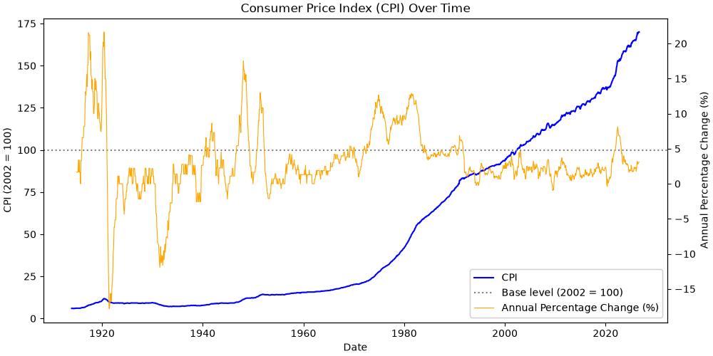

# FINE3300-2026-A2: CPI Graph and Inflation Calculator

Assignment #2 for FINE 3300 (Python for Finance Professionals), Fall 2026, Schulich School of Business.

**Author:** Marcus Maximus Reyes
**Repository:** https://github.com/marcus-maximus27/fine3300-2026-a2

## Overview

This project uses Pandas, NumPy and Matplotlib to work with the Consumer Price Index (CPI) for Canada, published by the Bank of Canada. It has two parts:

1. **CPI graph:** plots the monthly CPI from January 1914 to September 2026, together with its annual percentage change on a second (right-hand) axis, and a dotted line through the base level (2002 = 100).
2. **Inflation calculator:** replicates the [Bank of Canada Inflation Calculator](https://www.bankofcanada.ca/rates/related/inflation-calculator/) and enhances it. The Bank of Canada version accepts only a year for each period. This version accepts a **month and year** (YYYY-MM) for each period, so it uses the full monthly CPI data.

- **Data source:** Bank of Canada, Inflation Calculator data (CSV), series `STATIC_INFLATIONCALC` (Total CPI, monthly, 2002 = 100). Original source: Statistics Canada, Consumer Price Indexes for Canada, Monthly (V41690973).
- **Data range:** January 1914 to September 2026

## Files

| File | Description |
|---|---|
| `InflationCalculator.py` | Main program: loads and cleans the CPI data, creates the graph, and runs the calculator |
| `STATIC_INFLATIONCALC.csv` | Monthly CPI data downloaded from the Bank of Canada |
| `cpi_graph.png` | The CPI graph saved by the program |
| `requirements.txt` | Python packages and versions needed to run the program |
| `README.md` | Project description and write-up |

## Requirements

- Python 3
- pandas, NumPy and Matplotlib (exact versions in `requirements.txt`)

## How to Run

1. Clone the repository and move into its folder:
   ```bash
   git clone https://github.com/marcus-maximus27/fine3300-2026-a2.git
   cd fine3300-2026-a2
   ```
2. Create and activate a virtual environment, then install the packages:
   ```bash
   python3 -m venv .venv
   source .venv/bin/activate
   pip install -r requirements.txt
   ```
3. Run the program from the repository folder, so the CSV file can be found:
   ```bash
   python3 InflationCalculator.py
   ```
4. The CPI graph opens in a new window (and is saved as `cpi_graph.png`). **Close the graph window to continue to the calculator.**
5. When prompted, enter:
   - the **price** of the goods or services in CAD (for example `100`, `$1,250.50` or `1 250`)
   - the **first date** in `YYYY-MM` format (for example `2020-05`)
   - the **second date** in `YYYY-MM` format

## How It Works

### Part 1: Loading and cleaning the data

- The CSV file has 8 lines of metadata (terms and series description) above the column header, so it is read with `skiprows=8`.
- The columns are renamed to `Date` and `CPI`, and `Date` is converted from text to dates with `pd.to_datetime`.
- **Data quality fix:** the file contains two extra rows dated `1927-04-30` and `1932-04-30`, in addition to the normal `1927-04-01` and `1932-04-01` rows. Every other observation is dated the first of the month. Keeping only first-of-month rows leaves exactly one CPI value per month (1,353 months). Without this step, the 12-month change would compare the wrong months near those dates, and a lookup for April 1927 or April 1932 would return two rows.

### Part 2: The graph

- **CPI** is plotted on the left axis.
- **Annual percentage change** is plotted on the right axis (`twinx`). It is calculated as the 12-month change, comparing each month with the same month one year earlier (`pct_change(periods=12)`), which is the standard measure of annual inflation used by Statistics Canada and the Bank of Canada. The first 12 months (1914) have no prior-year value, so they are not plotted.
- A dotted horizontal line marks the **base level**, CPI = 100 (2002).

### Part 3: The calculator

**Input validation:** each input is requested again until it is valid.

| Input | Accepted | Rejected (with a message) |
|---|---|---|
| Price | Positive numbers; `$`, commas and spaces are removed first | Text, zero, negative numbers |
| Dates | `YYYY-MM` within the data range (1914-01 to 2026-09) | Wrong format, invalid months (e.g. `2020-13`), dates outside the data, empty input |

The year and month are extracted from each date and used to look up that month's CPI.

**Formulas:**

| Result | Formula |
|---|---|
| New price | price × (CPI₂ ÷ CPI₁) |
| Percent change | (new price − price) ÷ price × 100 |
| Number of months | (year₂ − year₁) × 12 + (month₂ − month₁) |
| Number of years | months ÷ 12 |
| Average annual rate of inflation | ((CPI₂ ÷ CPI₁)^(1 ÷ years) − 1) × 100 |

**Assumptions and design choices:**

- The average annual rate is the compound annual rate. The Bank of Canada page does not publish this formula.
- Because months are used, the number of years can include a fraction (for example, 25 months = 2.08 years). The Bank of Canada calculator only uses whole years.
- The second date can be earlier than the first. The calculator then shows what the price would have cost in the earlier month (a negative percent change), and the average annual rate is still reported as a positive inflation rate.
- If both dates are the same month, no time has passed, so the average annual rate is shown as 0.00%.
- Results are rounded to the nearest cent for display only. Calculations use full precision.

## CPI Graph



### Commentary

[Your commentary: 4 to 6 sentences on what the graph shows and the most interesting periods.]

## Sample Output

Inputs: price `[...]`, first date `[...]`, second date `[...]`

```
[Paste the full terminal output from one run here, from the first prompt to the closing line.]
```

## Sources

- Bank of Canada, Inflation Calculator: https://www.bankofcanada.ca/rates/related/inflation-calculator/
- Bank of Canada, Inflation Calculator data (CSV): https://www.bankofcanada.ca/valet/observations/STATIC_INFLATIONCALC/csv
- FINE 3300 Lectures 6 to 8 class examples (Pandas, Matplotlib, NumPy)
- pandas documentation: `read_csv` (`skiprows`), `to_datetime` (`format`), `reset_index`, `pct_change`: https://pandas.pydata.org/docs/
- Matplotlib documentation: `axhline`, `twinx`, `get_legend_handles_labels`, `savefig`: https://matplotlib.org/stable/
- NumPy documentation: `np.power`: https://numpy.org/doc/stable/
- Python documentation, format specification (`{:,.2f}`, `{:<35}`): https://docs.python.org/3/library/string.html#format-specification-mini-language
- Average annual inflation rate (compound annual growth rate) formula: https://wowa.ca/inflation-calculator

## AI Use Disclosure

[State how AI was used in this assignment, per the course AI policy.]
